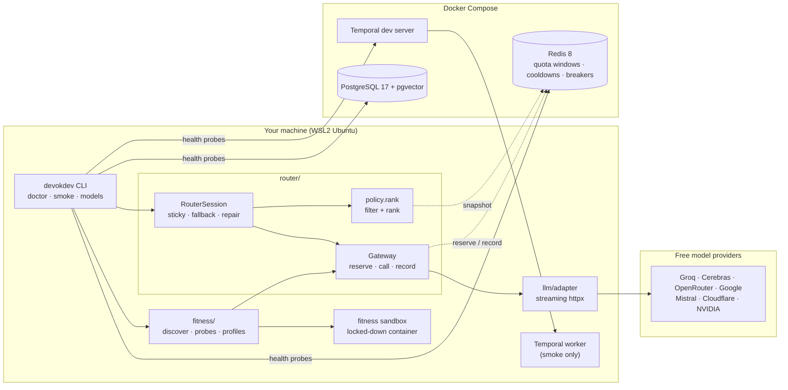

# Architecture

This file describes what exists **today**. The target architecture, with the reasoning, is in
[the decision records](adr/README.md). Each milestone updates this file.

## Current state: M1 (model gateway, router and fitness check)

All stack ports are bound to `127.0.0.1`. Provider keys live only in `.env`.

| Module | Responsibility |
| --- | --- |
| `config.py` | Typed settings from `DEVOKDEV_*` variables and `.env`; secrets as `SecretStr` |
| `cli.py`, `cli_models.py` | Typer entry points: `version`, `doctor`, `smoke`, `models list/discover/profile/chat/demo` |
| `health/` | Doctor: concurrent probes with timeouts and redaction, now including the model registry |
| `llm/messages.py` | Canonical conversation format; Devo-K-Dev's own tool-call IDs |
| `llm/registry.py` | Loads and validates `config/models.yaml`: providers, models, roles, limits, data policy |
| `llm/adapter.py` | One streaming OpenAI-compatible client over httpx; provider quirks; first-token deadline |
| `llm/errors.py`, `llm/ratelimits.py` | Failures classified into kinds; rate-limit headers parsed into windows |
| `llm/scripted.py` | Scripted fake provider and fault injection (tests, demo, chaos tests later) |
| `router/state.py`, `router/redis_state.py` | Quota windows, cooldowns, circuit breakers; memory and Redis (Lua) versions |
| `router/policy.py` | Pure ranking: filter with reasons, then rank by preference, tier, headroom |
| `router/actions.py` | The failure table |
| `router/gateway.py` | One call to one model: breaker, reserve, call, settle, learn, record |
| `router/router.py` | Sessions: stickiness, fallback, mid-task handoff, output repair, decision log |
| `fitness/` | Discovery against the registry, five probes, a hardened sandbox, cached profiles |
| `workflows/`, `activities/`, `runtime/` | The M0 smoke workflow; model calls become activities in M2 |

## How a routed call flows

1. An agent opens `router.session("backend")` and calls `complete(conversation)`.
2. The policy reads a snapshot from Redis (cooldowns, breakers, quota windows), filters out
   every model that cannot take the call (with a reason each), and ranks the rest.
3. The gateway checks the breaker, reserves quota in every window the call spends from (one
   atomic Lua script), and streams the call through the adapter.
4. On success, the gateway settles the real token count and stores the provider's
   rate-limit headers. On failure, it applies the failure table to shared state (benches,
   breaker counts), and the session moves to the next candidate with the same conversation.
5. Every step is a `Decision` with a reason code, logged as `router.decision`.

## Coming next

M2 adds `agents/` (the agent loop as Temporal activities, using the router), `sandbox/`
(workspaces and git worktrees, replacing the fitness sandbox), `context/` (budgets,
compaction, real tokenizers) and context branches.
