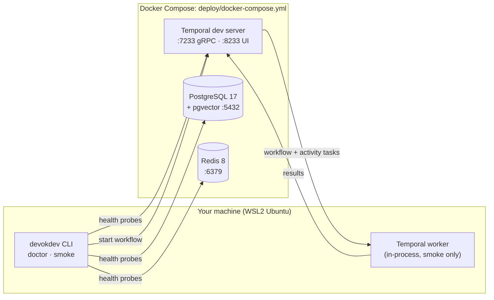

# Architecture

This file describes what exists **today**. The target architecture, with the reasoning, is in
[DESIGN.md](DESIGN.md). Each milestone updates this file.

## Current state: M0 (setup)

All ports are bound to `127.0.0.1`.

| Module | Responsibility |
| --- | --- |
| `config.py` | Typed settings from `DEVOKDEV_*` variables and `.env`; secrets as `SecretStr` |
| `cli.py` | Typer entry point: `version`, `doctor`, `smoke` |
| `health/runner.py` | Runs checks concurrently with per-check timeouts; turns exceptions into readable, redacted results |
| `health/probes.py` | Python, Docker, PostgreSQL + pgvector, Redis, Temporal, provider-key checks |
| `workflows/smoke.py` | `SmokeWorkflow`: deterministic orchestration of one activity with a retry policy |
| `activities/smoke.py` | `greet`: the side-effecting step |
| `runtime/smoke.py` | Connects a client, hosts a worker on a private task queue, executes the workflow |
| `telemetry/logging.py` | structlog configuration: console locally, JSON in CI |

## How a smoke run flows

1. `devokdev smoke` connects a Temporal client to `127.0.0.1:7233`.
2. It starts a worker on a fresh task queue `devokdev-default-smoke-<id>`, so the run can't
   collide with anything else.
3. It starts `SmokeWorkflow`. The server records `WorkflowExecutionStarted` and queues a
   workflow task.
4. The worker runs the workflow code, which asks for the `greet` activity. The server records
   that request and queues an activity task.
5. The worker runs `greet`; the result goes back to the server and into history.
6. The workflow completes; the client gets the result. Every step is visible in the Web UI.

The same pattern, at a much larger scale, carries every agent call from M2 onwards.

## Coming next

M1 adds `llm/` (canonical messages, provider adapters), `router/` (registry, quotas, circuit
breakers, handoff) and `fitness/` (model probes).
