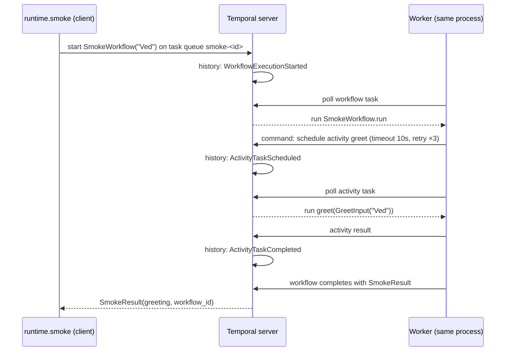

# M0 walkthrough: the foundation

M0 builds nothing an end user sees. It builds the ground everything else stands on: a
reproducible Python project, a local stack of the three services Devo-K-Dev depends on, a way
to prove they work, the first durable workflow, and a CI pipeline that keeps it all honest.

## 1. What was built

| File or folder | What it is |
| --- | --- |
| `pyproject.toml` | Package metadata, dependencies, and the config for ruff, mypy, pytest and coverage |
| `.python-version` | Pins Python 3.12; uv reads it |
| `src/devokdev/config.py` | Every setting, typed and validated, from `DEVOKDEV_*` env vars or `.env` |
| `src/devokdev/cli.py` | The `devokdev` command: `version`, `doctor`, `smoke` |
| `src/devokdev/health/runner.py` | Runs checks concurrently with timeouts; never crashes; redacts secrets |
| `src/devokdev/health/probes.py` | The six checks: Python, Docker, Postgres + pgvector, Redis, Temporal, keys |
| `src/devokdev/workflows/smoke.py` | The first Temporal workflow |
| `src/devokdev/activities/smoke.py` | The activity it calls |
| `src/devokdev/runtime/smoke.py` | Hosts a worker and runs the workflow |
| `src/devokdev/telemetry/logging.py` | Structured logs with structlog |
| `deploy/docker-compose.yml` | Temporal dev server, PostgreSQL 17 + pgvector, Redis 8 |
| `deploy/postgres/init/01-extensions.sql` | Turns on pgvector when the database is first created |
| `tests/` | 21 unit tests (two property-based), 2 integration tests |
| `Makefile` | One short command for every routine task |
| `.pre-commit-config.yaml` | Hooks on every commit: whitespace, ruff, gitleaks, mypy |
| `.github/workflows/ci.yml` | Four CI jobs: quality, integration, secrets, dependencies |
| `AGENTS.md`, `.github/copilot-instructions.md` | Instructions any coding agent reads |
| `docs/` | Design export, architecture, status, ADRs, this walkthrough, Windows setup |

## 2. How it works

### `devokdev doctor`

```mermaid
sequenceDiagram
    participant U as You
    participant CLI as cli.doctor
    participant R as health.runner
    participant P as probes (6)
    U->>CLI: devokdev doctor
    CLI->>CLI: get_settings() reads .env
    CLI->>R: run_checks(default_checks(settings), timeout, secrets)
    par every probe at the same time
        R->>P: wait_for(probe(), timeout)
        P-->>R: Outcome(ok/warn/fail, detail) or exception or timeout
    end
    R->>R: exception → FAIL with reason; optional FAIL → WARN; redact secrets
    R-->>CLI: list[CheckResult] in the original order
    CLI-->>U: table, then exit code 0 or 1
```

Three ideas carry over to the whole project:

- **Concurrency with isolation.** `asyncio.gather` runs every probe at once, and each one is
  wrapped in `asyncio.wait_for`, so the doctor takes as long as the slowest healthy check, and a
  hung service costs at most the timeout. One stuck agent will be handled the same way later.
- **Failures are data.** `_run_one` catches everything and turns it into a `CheckResult`. The
  doctor never prints a stack trace at you; it prints which check failed and why.
- **Secrets never leave.** Passwords and keys are `SecretStr`, which prints as `**********`.
  As a second line of defence, `redact()` scrubs every known secret out of error messages,
  because a driver can echo a connection string back in an exception.

### `devokdev smoke`: the first durable workflow



The split that matters:

- **Workflow code** (`workflows/smoke.py`) only *decides*. Temporal records every decision in an
  event history. If the worker crashes, another worker replays the history through the same
  code and lands in exactly the same state. That only works if the code makes the same choices
  every time, so workflows may not read files, call networks, check the clock or pick random
  numbers. The Python SDK runs workflows in a sandbox that blocks most of these.
- **Activity code** (`activities/smoke.py`) *does*. It can fail; the workflow's retry policy
  says how often to try again. Every model call and tool call in Devo-K-Dev will be an activity.
- `workflow.unsafe.imports_passed_through()` lets the workflow file import the activity's
  definition without the sandbox re-importing that module on every run.

### The local stack

`docker compose up -d --wait` starts three containers and waits until each one's healthcheck
passes, so `make up` returning means the stack is really ready. PostgreSQL's init script runs
once, on an empty volume, and turns on pgvector. Redis keeps an append-only file so counters
survive a restart. Temporal runs as its CLI's development server, which bundles the service,
an embedded database and the Web UI in one process.

### Quality gates

```
your commit ──► pre-commit hooks ──► push ──► CI on the pull request ──► merge to main
               whitespace, ruff,            quality · integration ·
               gitleaks, mypy               secrets · dependencies
```

## 3. Decisions

| Decision | Alternatives | Why this one |
| --- | --- | --- |
| **uv** for Python and dependencies | pip + venv, Poetry | One fast tool installs Python, resolves, locks with hashes and runs commands; `uv.lock` makes every machine identical |
| **src layout** (`src/devokdev`) | Package at the repo root | Tests import the installed package, not files that happen to sit next to them, so packaging mistakes show up in tests |
| **pydantic-settings** for config | `os.environ` lookups, python-dotenv | Typed, validated at start-up, one place to look, and `SecretStr` for free |
| **Typer** for the CLI | argparse, Click | Commands are typed functions; help text comes from type hints and docstrings |
| **structlog** | stdlib logging alone | Key-value events that become JSON in CI and traces later |
| Doctor as **concurrent probes with timeouts** | A shell script; sequential checks | Fast, testable with fake probes, and the same failure-handling pattern the agents will need |
| Docker check via the **`docker` CLI** | Docker SDK for Python | One less dependency in M0; the SDK arrives with the sandbox in M2 |
| **Temporal dev server** in Compose, in memory (ADR-036) | Full Temporal on PostgreSQL; `temporal` binary on the host | One container, Web UI included, zero setup. History is lost on `make down`, which is fine until runs must survive restarts |
| **Ports bound to 127.0.0.1** | Default `0.0.0.0` | Your databases are not reachable from the café Wi-Fi |
| **Pinned images, SHA-pinned Actions and hooks, verified gitleaks binary** (ADR-037) | Floating tags like `latest` or `v4` | A tag can be moved to malicious code; a SHA can't. The March 2026 LiteLLM compromise is the reason this matters |
| **pip-audit** in CI | osv-scanner | Reads the exact locked, hashed set from `uv export`; osv-scanner stays the Security agent's tool |
| **Integration job runs the real stack in CI** (ADR-038) | Unit tests only | Proves a clean machine can start the stack and pass the doctor, not just your laptop |
| **Hypothesis** property tests | Only example tests | `redact` must hold for *any* text and secret; Hypothesis generates hundreds of cases, including strange Unicode |
| Integration tests **opt-in** (`--run-integration`) | Always run | `make test` works anywhere in seconds; CI runs both |
| **Apache-2.0** | MIT | Same freedom plus an explicit patent grant |

## 4. How to check it

| Command | You should see |
| --- | --- |
| `make up` | Three containers reported `Healthy` |
| `make ps` | `postgres`, `redis`, `temporal` all `running (healthy)` |
| `make doctor` | Python, Docker, PostgreSQL + pgvector, Redis, Temporal `ok`; Model provider keys `warn`; "All required checks passed." |
| `make smoke` | `Namaste, Ved! Devo-K-Dev's stack is alive (activity attempt 1).` and a UI link |
| Open the UI link | The workflow, Completed, with its event history: started → activity scheduled → completed |
| `make check` | ruff: no issues; mypy: `Success: no issues found`; pytest: 21 passed, 2 skipped |
| `make test-integration` | 2 passed |
| `make down && make doctor` | Postgres, Redis and Temporal now `fail` with a reason each, exit code 1 |

Try breaking things on purpose:

- `docker compose -f deploy/docker-compose.yml stop redis`, then `make doctor`: only Redis fails.
- Put a wrong password in `.env`, run `make doctor`: Postgres fails, and the password does not
  appear in the output.

## 5. Interview questions this stage prepares you for

**Why Temporal instead of a task queue like Celery?**
Celery runs tasks; it doesn't remember a multi-step process. Temporal records every step of a
workflow in an event history, so a process that waits days for approval or survives a crashed
worker resumes exactly where it was. Signals and queries let outside code steer a running
workflow, which is how the Liaison will work.

**Why must workflow code be deterministic?**
Recovery works by replaying the recorded history through the workflow code. If the code made a
different decision on replay, for example because it read the clock or a random number, the
replayed state would not match the history. So all non-determinism lives in activities, whose
results are recorded.

**What's the difference between a workflow and an activity?**
A workflow orchestrates and must be deterministic; it is cheap and can run for months. An
activity performs one side effect, can fail, and is retried by policy with timeouts and
heartbeats.

**How do you keep secrets out of a repo and out of logs?**
`.env` is git-ignored and only `.env.example` is committed; gitleaks runs on every commit and on
the full history in CI; settings hold secrets as `SecretStr`; and diagnostic output passes
through a redaction step.

**What does pinning an Action to a commit SHA protect against?**
Tags are mutable. If an attacker takes over an action's repository, they can point `v4` at
malicious code and every workflow using `@v4` runs it. A full SHA identifies one exact commit.

**What is a lockfile with hashes, and why both?**
The lockfile fixes exact versions so every install is identical. The hashes make sure the
downloaded file is the one that was locked, so a tampered package on the index is rejected.

**What is property-based testing?**
Instead of hand-picking examples, you state a property that must always hold ("after redaction
the secret never appears") and the framework generates many inputs, then shrinks any failure to
the smallest example.

**Why `asyncio.wait_for` around each probe instead of one timeout around all of them?**
One global timeout would turn a single hung service into a failure of every check. Per-probe
timeouts isolate the failure and keep the healthy results.

**Why a src layout?**
It forces tests to import the installed package, so missing files or broken packaging fail in
tests instead of after release.
