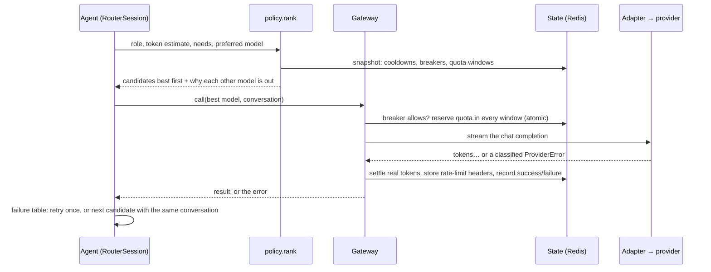

# M1 walkthrough: the model gateway, router and fitness check

M1 is the layer every agent will talk through. An agent says "I am the Backend Engineer,
here is my conversation"; the router decides which free model answers, keeps the call
alive when that model fails, and records why it chose what it chose. The fitness check
measures what each model can actually do, so later the plan can be checked against it.

Done when: **the router survives a 429** (it hands a live conversation to another model
and finishes) and **it profiles every model** you have a key for.

## 1. What was built

| File | What it is |
| --- | --- |
| `config/models.yaml` | The registry: 7 providers, 18 models, 19 roles, limits, data policy |
| `src/devokdev/llm/messages.py` | The canonical conversation format (Pydantic) |
| `src/devokdev/llm/registry.py` | Loads and strictly validates `models.yaml` |
| `src/devokdev/llm/adapter.py` | One streaming OpenAI-compatible client over httpx, for every provider |
| `src/devokdev/llm/errors.py` | Every failure turned into one `ProviderError` with a `kind` |
| `src/devokdev/llm/ratelimits.py` | Reads each provider's rate-limit headers |
| `src/devokdev/llm/tokens.py` | Cheap, pessimistic token estimates for budgeting |
| `src/devokdev/llm/scripted.py` | A fake provider for tests, the demo, and fault injection |
| `src/devokdev/router/state.py` | Quota windows, cooldowns, circuit breakers (in memory) |
| `src/devokdev/router/redis_state.py` | The same, shared across workers, as atomic Lua scripts |
| `src/devokdev/router/policy.py` | Signals in, ranked candidates out, a reason for every exclusion |
| `src/devokdev/router/actions.py` | The failure table: one rule per error kind |
| `src/devokdev/router/gateway.py` | One call to one model, with quota reserved and health recorded |
| `src/devokdev/router/router.py` | Sessions, stickiness, fallback, handoff, repair, decision log |
| `src/devokdev/router/factory.py`, `demo.py` | Wiring, and the offline demo |
| `src/devokdev/fitness/` | Discovery, six probes, the Docker sandbox, cached profiles |
| `src/devokdev/cli_models.py` | `devokdev models list / discover / profile / chat / demo` |
| `tests/` | 180 unit tests (159 new) and 22 integration tests (Redis contract, shared state, sandbox) |

## 2. How it works

### One call, end to end

### The policy: filter, then rank

For every model, `policy.judge` answers "can it take this call?" in a fixed order, and the
first "no" becomes the reason you see in `devokdev models list --role backend`:

`no_key` → `role_not_supported` (tier 0) → `missing_capability` (tools, JSON, vision) →
`context_too_small` → `trains_on_prompts` (private data) → `same_family` (reviewers) →
`cooling_down` / `circuit_open` → `failed_this_task` → `no_quota` / `too_large_for_quota`.

The survivors are ranked: the session's preferred model first (stickiness), then quality
tier for the role's class, then quota headroom, then providers that do not train on
prompts, then by name so the order is deterministic.

### Failures: the table in code

| Failure | How it is detected | Bench the model | Breaker | This call |
| --- | --- | --- | --- | --- |
| Rate limit | 429, `retry-after` | retry-after (default 30 s) | | next model |
| Daily quota | 429 mentioning per-day, or a day window at 0 | until reset (default 1 h) | | next model |
| Credits, access | 402, 403 | until reset (default 1 h) | | next model |
| Bad key | 401 | the whole provider, 1 h | | next model |
| Server, network | 5xx, dropped stream | | counts | retry once, then next |
| Hung stream | nothing streamed before the deadline | | counts | next model |
| Context too long | 400/413 with a context message | | | a model with a bigger window |
| Invalid output | unknown tool, broken JSON, empty | | | one repair prompt, then next |
| Everything out | no candidate left | | | `AllModelsUnavailable(retry_at)` |

Benches live in Redis, so a 429 seen by one agent benches the model for all of them
(`tests/integration/test_router_redis.py` proves it with two routers).

### Mid-task handoff

Conversations are stored only in the canonical format. When a model fails, the router sends
the same messages to the next one, converted by `to_provider_messages` for that provider's
quirks. Two details make this safe:

- **Tool-call IDs are ours.** Provider IDs are replaced with nine random letters and digits,
  the strictest format any provider accepts (Mistral rejects anything else). A tool call
  made on Cloudflare can be answered on Cerebras.
- **Reasoning is kept apart.** Models that stream hidden reasoning (`reasoning`, `reasoning_content`)
  have it stored in `CompletionResult.reasoning` but never replayed to the next model.

### Quota: reserve, settle, overwrite

Each limit is a *window*: `model:groq/openai/gpt-oss-120b|tokens|minute` with a limit, what
is left, and when it resets. Before a call, the gateway **reserves** one request and the
estimated tokens in every window the call spends from (the model's and the provider's shared
ones), all or nothing, in one Lua script, so two workers can never both take the last
request. After the call it **settles** with the real token count. Rate-limit headers then
**overwrite** our numbers, because the provider is the source of truth.

### Circuit breakers

Three server or network failures in a row open a model's breaker for 60 s. After that it is
half-open: exactly one trial call goes through. Success closes it; failure reopens it for
twice as long (capped at 15 minutes). This stops the router from hammering a provider that
is down, and lets it notice when the provider is back.

### Sticky sessions and switching back

A session stays on the model it last used. After a fallback, it stays on the fallback model
and only tries its original ("home") model again at the start of a later call, once 120 s
have passed. Switching mid-session costs consistency and prompt-cache hits.

### The fitness check

`devokdev models profile` runs five probes per model through the gateway (so they spend
quota like any call), scores each from 0 to 1 with deterministic checks, and caches the
result as JSON in `.devokdev/fitness/`:

| Probe | Checks | Scored by |
| --- | --- | --- |
| instructions | an exact three-line format | each line right |
| json | a JSON object matching a schema | valid JSON, then the schema (Pydantic) |
| tool_call | the right tool with the right arguments | tool, city, unit |
| code_fix | fixes a bug so hidden tests pass | the tests, run in a locked-down container |
| recall | finds a code hidden mid-text at 2k and 8k tokens (64k with `--depth full`) | each length |

Speed (median time to first token, tokens per second) comes from the same calls. Recall
lengths are capped by the model's context and its tokens-per-minute limit: Groq's 8k
tokens a minute means only the 2k test fits. A profile goes stale when the probe suite or
the model's registry entry changes, or after 14 days.

The code-fix probe runs model-written code, so it runs in a container with no network, no
capabilities, a read-only file system, a non-root user, and memory, CPU, process and time
limits. If Docker is not available, that probe is skipped rather than run on your machine.

## 3. Decisions

| Decision | Alternatives | Why this one |
| --- | --- | --- |
| **httpx directly**, not the openai SDK (ADR-041) | openai SDK; LiteLLM | The router needs raw status codes, error bodies, rate-limit headers and first-token timing on every call, and the SDK's automatic retries would fight the router's. httpx's `MockTransport` also gives keyless tests |
| **Stream every call** | Non-streaming | The only way to tell "slow" from "hung": no token before the deadline means abandon and switch |
| **One `ProviderError` with a `kind`** | A class per error | The router acts on kinds, and one `match` statement is the whole failure table |
| **Canonical 9-character tool-call IDs** (ADR-043) | Keep provider IDs; translate per provider | Satisfies the strictest provider, so handoff needs no mapping table |
| **Reserved quota windows in Redis via Lua** (ADR-042) | Token buckets; counting after the call | Provider limits are windows, so mirroring them is simplest; reserving before the call is what makes concurrent agents safe; Lua makes it atomic |
| **Headers overwrite our counts** | Trust our own counting | Other tools may use the same key; the provider knows the truth |
| **Policy as a pure function** | Ranking inside the router loop | Every rule is unit-tested with plain data, no network or clock |
| **Role classes with tiers** (ADR-046) | A tier per model per role | 19 roles share 5 classes; adding a role is one line |
| **Unknown data policy = trains on prompts** (ADR-008) | Assume it doesn't | Fails safe: private code can never reach an unchecked provider |
| **Contract tests on both state backends** | Test only the memory version | The Lua and Python versions must behave identically; the same 15 tests prove it, and they caught a Lua reserved-word bug |
| **Profiles as JSON files** (ADR-044) | A Postgres table | A recomputable cache needs no schema or migration yet; M3 can move it when the pre-flight check needs queries |
| **Code-fix probe in a hardened container** (ADR-045) | Run it in a subprocess | Model-written code never runs on the host (ADR-007) |
| **Fall back to in-memory state** when Redis is down | Refuse to start | A single CLI command still works, and says so in its output |
| **No compaction in M1** | Summarise on handoff | Compaction needs the context manager and real tokenizers (M2). Until then a context error moves the call to a larger window |

## 4. How to check it

Run these from the repo root in WSL.

| Command | You should see |
| --- | --- |
| `git pull && uv sync` | New dependencies httpx and PyYAML installed |
| `make check` | ruff and mypy clean; 180 passed, 22 skipped (the integration tests) |
| `make up && make test-integration` | All integration tests pass, including the Redis contract and the sandbox (the first run pulls `python:3.12.13-slim`) |
| `make demo` | Four turns: a tool call; `rate_limited → switched to …`; `staying on …`; `cooldown over → switched back to …` |
| `make models` | 18 models; `0 of 18 models usable` until you add keys |
| `uv run devokdev models list --role reviewer` | The ranking, and why every other model is out (`no_key set groq_api_key in .env`) |
| `make doctor` | A new `Model registry` row: `18 models, 0 usable` (warn) |

With at least one key (see below):

| Command | You should see |
| --- | --- |
| `uv run devokdev models chat "Say namaste in three languages"` | An answer, then `routed to …` and `… answered` |
| `uv run devokdev models chat "Hi" --role backend --simulate-429` | `rate_limited → switched to …`: a live fallback |
| `uv run devokdev models discover` | Each provider: registered models found, any `missing` (renamed) or `new` |
| `uv run devokdev models profile` | One row per usable model: probe scores, first-token time, tokens per second |

**Try breaking things on purpose:**

- Change a model name in `models.yaml` to a wrong one, then `devokdev models discover`: it is
  listed as `missing`. Then `models chat`: a 404, `model_unavailable → switched to …`.
- Put a typo in a field name in `models.yaml`, then `make models`: a clear error naming the
  field, not a traceback.
- Set `DEVOKDEV_ROUTER_FIRST_TOKEN_TIMEOUT_S=0.01` and chat: every model hangs, and you get
  `AllModelsUnavailable` with the reasons.

## Getting free keys

You only need one provider to start. Groq and Cerebras together give the 429 demo two
providers that do not train on your prompts. Paste keys only into `.env`, never into a chat
or a commit (gitleaks blocks commits that contain them).

| Provider | Where | `.env` variable | Trains on prompts |
| --- | --- | --- | --- |
| Groq | console.groq.com → API Keys | `DEVOKDEV_GROQ_API_KEY` | no |
| Cerebras | cloud.cerebras.ai → API Keys | `DEVOKDEV_CEREBRAS_API_KEY` | no |
| OpenRouter | openrouter.ai → Keys | `DEVOKDEV_OPENROUTER_API_KEY` | may, for free models |
| Google AI Studio | aistudio.google.com → Get API key | `DEVOKDEV_GOOGLE_API_KEY` | yes, in India |
| Mistral | console.mistral.ai → API Keys (needs phone) | `DEVOKDEV_MISTRAL_API_KEY` | yes, on the free plan |
| Cloudflare | dash.cloudflare.com → Workers AI → API token, plus account ID | `DEVOKDEV_CLOUDFLARE_API_TOKEN`, `DEVOKDEV_CLOUDFLARE_ACCOUNT_ID` | no |
| NVIDIA NIM | build.nvidia.com → API key (needs phone) | `DEVOKDEV_NVIDIA_API_KEY` | unknown, treated as yes |

After adding keys: `make doctor`, then `uv run devokdev models discover`, then
`uv run devokdev models profile`.

## 5. Interview questions this stage prepares you for

**How does your router handle a provider's rate limit in the middle of a task?**
The adapter classifies the 429 as `rate_limited` and reads `retry-after`. The gateway benches
that model in Redis until then, so every agent sees it. The router marks the model as failed
for this call and asks the policy for the next candidate. Because the conversation is kept in
our own canonical format, the next model gets the same messages, converted for its provider,
and the agent never notices except in the decision log.

**Why not just use LiteLLM or OpenRouter's own fallbacks?**
Routing is the core of the project, so it should be ours, and the key-holding layer should
have few dependencies (LiteLLM's March 2026 supply-chain compromise is the cautionary tale).
OpenRouter's fallbacks only cover models on OpenRouter; we route across eight providers with
different limits, data policies and quirks.

**How do two workers avoid both using the last request of a minute?**
Quota is reserved before the call, not counted after it. The reservation checks every window
and takes from all of them in one Lua script; Redis runs a script without interleaving other
commands, so check-and-take is atomic. A test fires ten reservations at once against a
two-per-minute window and asserts exactly two succeed.

**What is a circuit breaker and why use one here?**
After repeated failures, stop calling a dependency for a while (open), then let one trial
request through (half-open) to see if it recovered. Without it, every agent would keep
hitting a provider that is down, wasting time and quota. Ours doubles the open time each
time the trial fails.

**How do you detect a hung LLM call?**
Every call streams. If nothing (not even reasoning tokens) arrives before a deadline, the call
is abandoned as `hung_stream`. Keep-alive comments do not count; otherwise a stalled model
that sends `: PROCESSING` lines would look alive. After the first token, a stall timeout
between chunks and a total deadline still apply.

**Why are tool-call IDs generated by you rather than the provider?**
So a conversation can move between providers. Mistral only accepts nine alphanumeric
characters; other providers accept anything. Generating IDs in the strictest format means a
tool call from one provider can be answered on any other.

**How do you test code that talks to paid or rate-limited APIs?**
httpx lets you swap the network for a transport. `ScriptedTransport` returns scripted
streamed answers, 429s with headers, hung streams and dropped connections, so the router's
failure handling is tested exactly, without keys, in milliseconds. The same fake powers the
offline demo.

**What are contract tests?**
One test suite that any implementation of an interface must pass. Ours runs against both the
in-memory and the Redis router state, so the Lua scripts cannot drift from the Python
version unnoticed.

**How do you know which models are good for which role?**
Today, starting tiers in the registry plus a measured fitness profile per model: instruction
following, JSON, tool calls, a real bug fix checked by tests in a sandbox, and long-context
recall. The evals in M8 replace the starting tiers with measured winners.
